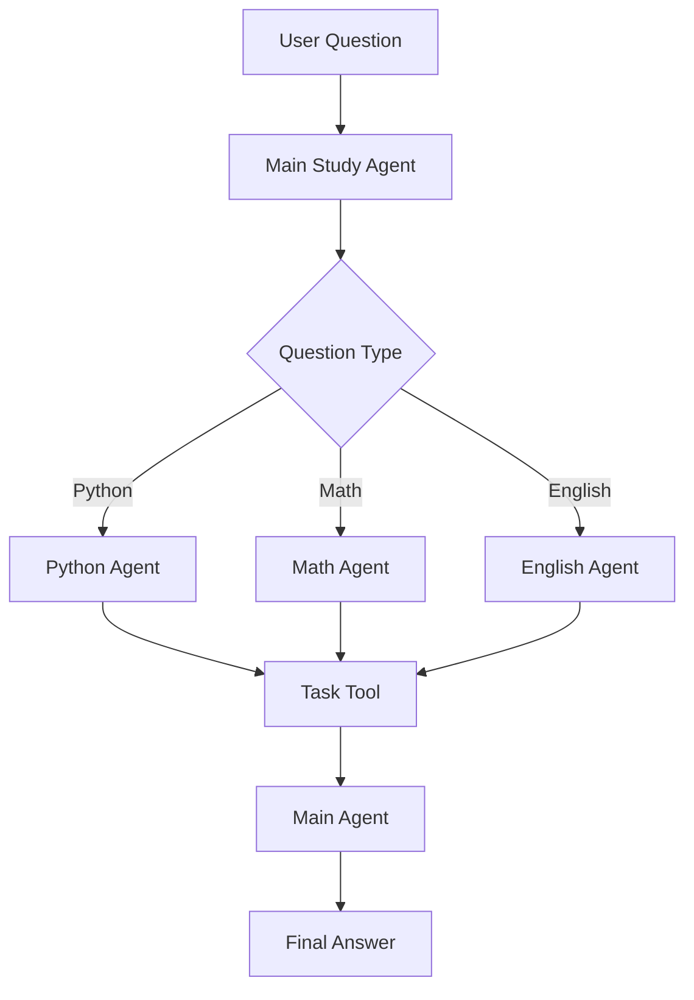

# 🤖 Multi-Agent Study Assistant

### An Intelligent Study Assistant Built with LangChain and Groq

A multi-agent AI study assistant that intelligently handles student questions by routing them to specialized agents. It uses a main supervisor agent to identify the user's request and delegate Python programming, mathematics, and English-related questions to dedicated specialist agents.

The system is built using Python, LangChain, LangChain Groq, and specialized agent tools to provide focused and context-aware educational assistance.

## 🚀 How to Use

### Prerequisites

- Python 3.10+
- Git
- Groq API Key

### 1. Clone the Repository

```bash
git clone https://github.com/hmzsrx/first-multi_agent.git
cd first-multi_agent
```

### 2. Create Virtual Environment

**Windows:**

```bash
python -m venv venv
venv\Scripts\activate
```

**Mac/Linux:**

```bash
python3 -m venv venv
source venv/bin/activate
```

### 3. Install Dependencies

```bash
pip install -r requirements.txt
```

### 4. Configure Environment Variables

Create a `.env` file:

```env
GROQ_API_KEY=your_groq_api_key
```

### 5. Run the Application

```bash
python main.py
```

Enter your study questions in the terminal. Type `exit` or `quit` to close the application.

## 🏗️ Project Architecture



### Technology Stack

- Python
- LangChain
- LangChain Groq
- Groq LLM
- Python Dotenv

## ✨ Key Features

- Multi-agent architecture.
- Intelligent question routing.
- Specialized Python programming agent.
- Dedicated Mathematics agent.
- Dedicated English learning agent.
- Agent discovery through tools.
- Task delegation between agents.
- Streaming AI responses.
- Language and writing-style matching.

## 👨‍💻 Contributing

Contributions are welcome!

1. Fork the repository.
2. Create a new branch.
3. Make your changes.
4. Test the application.
5. Commit and push your changes.
6. Submit a Pull Request.

Keep agent responsibilities clear and maintain the existing tool structure.

## ⚠️ Known Issues & Future Improvements

Potential improvements:

- Add more specialized study agents.
- Add conversation memory.
- Introduce a web-based interface.
- Add user authentication.
- Improve error handling and agent monitoring.

## ⭐ Support

If you find this project useful, consider giving it a ⭐ on GitHub.

---

**Built with ❤️ using Python, LangChain, and Groq.**
